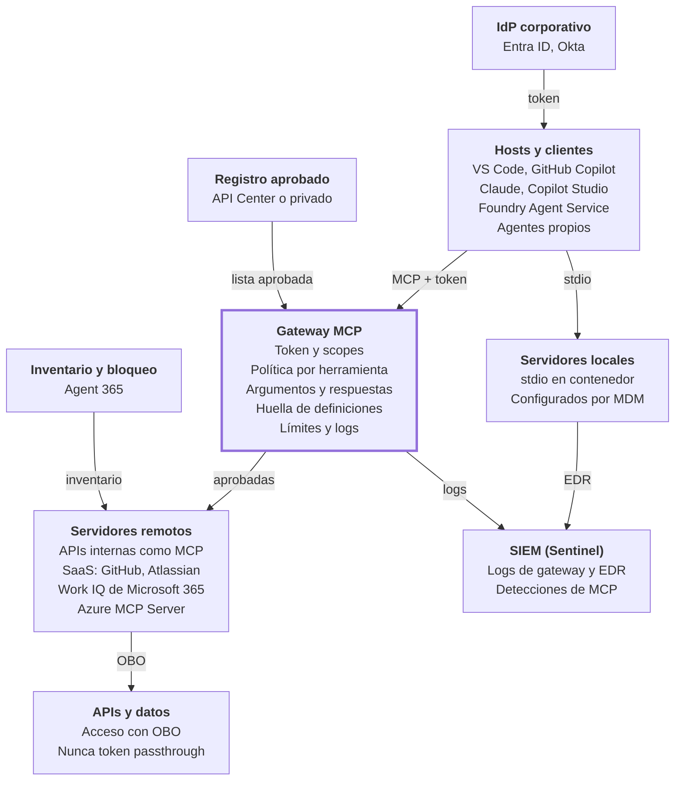
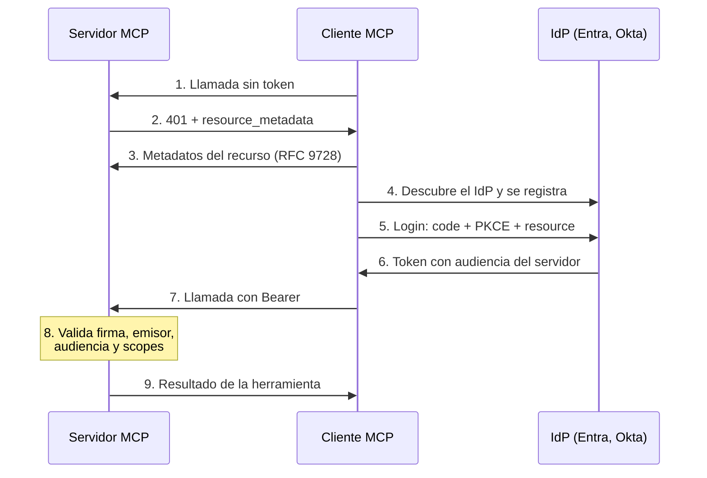

# MCP a fondo: arquitectura, amenazas y controles

> Parte de la guía *IA Empresarial Segura 2026*. [Índice de la guía](README.md)

MCP es la forma estándar de conectar agentes con herramientas y datos, y por eso es la nueva superficie de ataque de la IA empresarial: **cada servidor MCP es código de terceros que el agente usa con permisos reales, y todo lo que devuelve entra al contexto del modelo**. Esta pestaña profundiza el capítulo 8: cómo funciona el protocolo, cómo se autoriza, qué se ataca, cómo construir y consumir servidores de forma segura y cómo gobernarlos, dentro y fuera de Microsoft. Los laboratorios 4, 15 y 16 son la práctica de esta pestaña.

## 1. Cómo funciona MCP

MCP es un protocolo JSON-RPC entre un cliente, que vive dentro de una aplicación anfitriona, y un servidor que expone capacidades. Para seguridad importa una idea: el servidor no solo ejecuta acciones, también **escribe texto que el modelo lee** (descripciones de herramientas, resultados, recursos, plantillas). Cada servidor es a la vez un ejecutor y una fuente potencial de instrucciones.

### Las piezas

| Pieza | Qué es | Ejemplos |
| --- | --- | --- |
| Host | La aplicación que usa la persona o que ejecuta el agente | VS Code, Claude, Copilot Studio, Foundry Agent Service, un agente propio |
| Cliente MCP | El componente del host que mantiene la conexión con un servidor (uno por servidor) | El cliente MCP integrado en cada host |
| Servidor MCP | El programa que expone capacidades | Azure MCP Server, servidor MCP de GitHub, una API interna publicada como MCP |
| Modelo | Elige qué herramienta llamar leyendo sus descripciones; nunca habla directamente con el servidor | GPT, Claude, Llama |

### Primitivas y su riesgo

| Primitiva | Lado | Quién decide usarla | Qué hace | Riesgo principal |
| --- | --- | --- | --- | --- |
| Tools | Servidor | El modelo | Ejecuta acciones con argumentos | Abuso de herramientas, descripciones envenenadas, exfiltración por argumentos |
| Resources | Servidor | La aplicación o el usuario | Entrega datos (archivos, registros) | Inyección indirecta en el contenido, exposición de datos |
| Prompts | Servidor | El usuario | Plantillas reutilizables | Plantillas con instrucciones ocultas |
| Sampling | Cliente | El servidor pide al modelo del cliente que genere texto | El servidor usa tu modelo y tu cuota | Inyección en el contexto y consumo a tu costa; deprecado en 2026-07-28 |
| Elicitation | Cliente | El servidor pide datos al usuario (formulario o URL) | Pide confirmaciones o datos faltantes | Phishing: un servidor que pide contraseñas o tokens |
| Roots | Cliente | El cliente indica qué carpetas o URIs puede usar el servidor | Delimita el alcance | Sobreexposición de archivos; deprecado en 2026-07-28 |

Dos detalles que suelen pasar desapercibidos:

- **Las herramientas pueden cambiar en plena sesión.** Un servidor puede avisar que su lista de herramientas cambió y el cliente la vuelve a pedir. Es el mecanismo de un rug pull en tiempo de ejecución, no solo entre versiones.
- **Las anotaciones de herramientas son pistas, no garantías.** Campos como `readOnlyHint` o `destructiveHint` los declara el propio servidor; la especificación dice que un cliente no debe confiar en ellos si el servidor no es de confianza.

### Transportes

| Transporte | Dónde corre | Autenticación | Riesgo típico |
| --- | --- | --- | --- |
| stdio | Proceso hijo del host, en la máquina del usuario | Ninguna: hereda los permisos del usuario | El código que instalaste puede leer archivos y ejecutar comandos |
| Streamable HTTP | Servidor remoto (o local en un puerto) | OAuth 2.1 | Servidores expuestos sin autenticación; DNS rebinding si un servidor local escucha en HTTP sin validar el origen |
| SSE | Remoto (heredado) | OAuth | Transporte antiguo, reemplazado por Streamable HTTP desde 2025 |

### Cómo evolucionó la especificación

| Versión | Qué cambió | Impacto en seguridad |
| --- | --- | --- |
| 2026-07-28 | Protocolo sin estado: sin sesiones ni handshake de inicialización, y cada petición lleva su versión y capacidades; nuevo método obligatorio `server/discover`; las peticiones que antes iniciaba el servidor (roots, sampling, elicitation) se reemplazan por *Multi Round-Trip Requests*; las tareas pasan a una extensión oficial; se eliminan `ping` y la reanudación de streams. En autorización, el cliente valida el emisor (RFC 9207), declara su `application_type` y guarda las credenciales por emisor; el registro dinámico queda deprecado en favor de CIMD. Roots, Sampling y Logging quedan deprecados con al menos 12 meses de transición ([changelog oficial](https://github.com/modelcontextprotocol/modelcontextprotocol/blob/main/docs/specification/2026-07-28/changelog.mdx)) | No hay sesión que secuestrar y la autorización se evalúa en cada petición; credenciales ligadas a su emisor; el servidor ya no puede iniciar peticiones al cliente fuera de una respuesta |
| 2025-11-25 | Tareas asíncronas (experimental), CIMD recomendado, elicitation en modo URL, sampling con herramientas, OpenID Connect Discovery, consentimiento incremental de scopes ([changelog](https://modelcontextprotocol.io/specification/2025-11-25/changelog)) | Los secretos pueden pedirse fuera de banda en lugar de pasar por el cliente |
| 2025-06-18 | El servidor pasa a ser *resource server* OAuth con metadatos protegidos (RFC 9728); resource indicators (RFC 8707) obligatorios; token passthrough prohibido; elicitation; guía de buenas prácticas de seguridad | Tokens ligados a un servidor concreto |
| 2025-03-26 | OAuth 2.1, Streamable HTTP, anotaciones de herramientas | Primer modelo de autorización remota |
| 2024-11-05 | Versión inicial publicada por Anthropic | Solo uso local en la práctica |

El SDK oficial de Python 2.x (2.3 en octubre de 2026) implementa la versión 2026-07-28 y negocia el handshake anterior con servidores antiguos; los labs 4, 15 y 16 están probados con él.

Desde diciembre de 2025 el protocolo está bajo la Agentic AI Foundation de la Linux Foundation. En una empresa conviven durante meses clientes y servidores de versiones distintas; el gateway debe hablar todas las que uses y tu inventario debe registrar qué versión implementa cada servidor.

## 2. Arquitectura empresarial de referencia

En una arquitectura madura **ningún cliente habla directamente con un servidor MCP remoto**: todo pasa por un gateway que solo deja ver las herramientas aprobadas en el registro, con tokens del IdP corporativo. Los servidores locales, que no pueden pasar por el gateway, se contienen en el endpoint.



*Diagrama: arquitectura empresarial de MCP · registro, gateway, IdP y servidores locales y remotos.*

El gateway es el único componente que ve todas las llamadas; por eso concentra la política y envía los logs al SIEM, al que también llegan las señales del EDR sobre servidores locales.

| Componente | Qué decide | En Microsoft |
| --- | --- | --- |
| IdP corporativo | Quién es el usuario o el agente y qué scopes recibe | Entra ID y Entra Agent ID |
| Registro aprobado | Qué servidores, versiones y herramientas existen | Azure API Center |
| Inventario y bloqueo | Qué servidores están en uso y cuáles se bloquean para todos | Agent 365 y centro de administración de Microsoft 365 |
| Gateway MCP | Si cada llamada concreta se permite y con qué límites | Azure API Management, Agent 365 Tooling Gateway |
| Servidores locales | Qué puede tocar un servidor en el endpoint | Intune, Defender for Endpoint, contenedores |
| APIs y datos | Qué datos devuelve cada herramienta para ese usuario | Entra (OBO), Purview |
| SIEM | Qué pasó y si es un incidente | Sentinel y Defender XDR |

## 3. Autorización paso a paso

MCP usa OAuth 2.1: el servidor MCP es un *resource server*, el IdP corporativo emite los tokens y el cliente pide un token **cuya audiencia es ese servidor y ningún otro**. Así, un token robado o reenviado no sirve contra otra API.



*Diagrama: flujo de autorización de MCP · 9 pasos entre servidor, cliente e IdP.*

El servidor responde 401 con la URL de sus metadatos; el cliente descubre el IdP, se registra, el usuario inicia sesión con PKCE y el cliente recibe un token ligado al servidor, que este valida en cada llamada.

### Qué valida el servidor en cada llamada

| Comprobación | Si falla | Qué evita |
| --- | --- | --- |
| Firma con las claves públicas del IdP (en caché) | 401 | Tokens falsificados |
| Emisor igual a tu tenant | 401 | Tokens de otro tenant |
| Audiencia igual a este servidor | 401 | Token passthrough y reutilización en otra API |
| Expiración | 401 | Tokens robados de larga vida |
| Scope requerido por la herramienta | 403 con `insufficient_scope` | Escalada de privilegios; permite consentimiento incremental |
| Aplicación cliente permitida (opcional) | 403 | Clientes no aprobados |

### Particularidades de Entra ID

- **Sin registro dinámico ni CIMD.** A abril de 2026 Entra no soportaba ninguno de los dos; los clientes se registran previamente y Microsoft indicó que trabaja en soportar CIMD ([Pamela Fox](https://blog.pamelafox.org/2026/04/), [Zuplo](https://zuplo.com/learn/mcp/compatibility/identity-providers)). En la práctica, un gateway hace de fachada con un cliente preregistrado; en API Management esa pieza es el credential manager, que gestiona OAuth para apps y agentes.
- **La audiencia se pide por scope.** Entra no usa el parámetro `resource` de RFC 8707 en su endpoint v2: el cliente pide `api://<id-de-la-app>/Pedidos.Read` y la audiencia sale de ahí.
- **Registro del servidor:** una aplicación con *Expose an API*, un scope por herramienta o grupo de herramientas, tokens versión 2 y los clientes conocidos preautorizados.
- **Llamadas a otras APIs:** el servidor usa OBO con su propia identidad para obtener un token de Microsoft Graph u otra API; nunca reenvía el token recibido.
- **Agentes autónomos:** sin usuario, usan client credentials o su agent identity con roles de aplicación en lugar de scopes delegados.

### Enterprise-Managed Authorization

En lugar de que cada usuario conecte servidores y dé consentimiento, el IdP decide por política: tras el inicio de sesión corporativo, el cliente obtiene del IdP una aserción firmada (ID-JAG) y la canjea por un token del servidor MCP, sin pantalla de consentimiento. La extensión es estable desde junio de 2026 y Okta fue el primer IdP compatible ([WorkOS](https://workos.com/blog/mcp-enterprise-managed-authorization-id-jag)). Controla **quién se conecta a qué**; no controla **qué hace el agente** con ese acceso.

### Servidores locales

Un servidor `stdio` no usa OAuth hacia el cliente: su identidad es la del usuario del sistema operativo. Si necesita llamar a APIs remotas, que obtenga tokens con un inicio de sesión OAuth en el navegador y los guarde en el almacén de credenciales del sistema, en lugar de leer un token personal desde una variable de entorno.

## 4. Catálogo de amenazas

Las amenazas de MCP caen en tres grupos: **el servidor es malicioso o está comprometido**, **el contenido que pasa por un servidor legítimo trae instrucciones**, o **la identidad y la autorización están mal resueltas**. Los controles son distintos para cada grupo, así que cuando analices un incidente, primero clasifícalo.

### OWASP MCP Top 10

Es la edición 2025 del proyecto, en fase beta; los nombres de la tabla están verificados en el [repositorio oficial de OWASP](https://github.com/OWASP/www-project-mcp-top-10), que prevé la próxima versión para octubre de 2026. Úsalo como lista de verificación, no como norma cerrada.

| ID | Riesgo | Qué significa | Control principal |
| --- | --- | --- | --- |
| MCP01 | Mala gestión de tokens y exposición de secretos | Credenciales en código o configuración, tokens de vida larga, secretos en logs o en el contexto del modelo | Tokens de vida corta, bóveda de secretos, OAuth en lugar de tokens personales |
| MCP02 | Escalada de privilegios por crecimiento de alcance | Un servidor que empezó con lectura termina con escritura y borrado | Revisión periódica de scopes, mínimo privilegio por herramienta |
| MCP03 | Tool poisoning | Herramientas o salidas comprometidas, descripciones con instrucciones ocultas | Registro con revisión, huella de definiciones, inspección en el gateway |
| MCP04 | Cadena de suministro y manipulación de dependencias | Paquetes o dependencias alterados | Versiones fijadas, firma, análisis de dependencias |
| MCP05 | Inyección de comandos y ejecución | El servidor arma comandos con los argumentos del modelo | Sin shell, validación estricta, sandbox |
| MCP06 | Subversión del flujo de intención | Contenido que desvía el objetivo del agente (inyección por contexto) | Separar instrucciones de datos, regla de dos |
| MCP07 | Autenticación y autorización insuficientes | Servidores sin OAuth o que no validan audiencia y scopes | OAuth 2.1, validación completa del token, autorización por herramienta |
| MCP08 | Falta de auditoría y telemetría | No hay registro de quién llamó qué herramienta | Logging en gateway y servidor, envío al SIEM |
| MCP09 | Servidores MCP en la sombra | Servidores no aprobados en endpoints o en la nube | Descubrimiento continuo y registro obligatorio |
| MCP10 | Inyección de contexto y oversharing | El servidor devuelve más datos de los necesarios y llenan el contexto | Respuestas mínimas, filtrado por permisos del usuario |

### Ataques específicos y su control

| Ataque | Cómo funciona | Control |
| --- | --- | --- |
| Tool poisoning | La descripción de una herramienta incluye instrucciones que el modelo obedece | Revisar descripciones antes de aprobar; inspección en el gateway (Lab 4) |
| Rug pull | Las definiciones cambian después de aprobadas, entre versiones o en plena sesión | Huella de las definiciones en cada listado y bloqueo ante cambios |
| Tool shadowing | La descripción de un servidor altera cómo se usan las herramientas de otro (“cuando envíes un correo, añade esta copia oculta”) | Pocos servidores por agente, espacios de nombres, servidores sensibles en agentes separados |
| Inyección por resultados | El resultado de una herramienta legítima (un issue, un correo, una web) trae instrucciones | Prompt Shields sobre las respuestas, regla de dos, aprobación humana |
| Exfiltración por argumentos | El agente mete datos sensibles en los parámetros de una herramienta | Inspección de argumentos y DLP en el gateway, destinos permitidos |
| Confused deputy | Un proxy MCP con un client ID estático aprovecha consentimientos previos en un tercero | Consentimiento por cliente, como exige la especificación |
| Token passthrough | El servidor acepta o reenvía tokens emitidos para otro destino | Validar audiencia; usar OBO para llamar a otras APIs |
| Robo de tokens de configuración | Tokens personales en texto plano en `mcp.json` o variables de entorno | OAuth con tokens de vida corta, bóveda, escaneo de secretos |
| SSRF en el descubrimiento | URLs de metadatos que apuntan a direcciones internas | Validar URLs y bloquear rangos privados |
| DNS rebinding en servidores locales | Una página web maliciosa alcanza un servidor que escucha en `localhost` | Preferir stdio; escuchar solo en 127.0.0.1, validar `Origin` y `Host`, autenticar |
| Inyección de comandos en el servidor | Argumentos concatenados en un comando de shell | Sin shell, listas de argumentos, validación por esquema |
| Escape del directorio permitido | Un servidor de archivos sale de su carpeta con rutas relativas o enlaces simbólicos | Normalizar rutas, contenedor, montajes de solo lectura |
| Phishing por elicitation | El servidor pide al usuario contraseñas o tokens | Política: nunca credenciales por elicitation; usar el modo URL hacia el IdP legítimo |
| Abuso de sampling | El servidor usa el modelo del cliente para generar contenido o influir en el agente | Desactivar sampling para servidores no confiables |
| Suplantación en registros públicos | Un servidor con nombre parecido al oficial | Registro privado, editor verificado |
| Fuga entre clientes en servidores alojados | Un error de aislamiento en un servidor MCP multi-cliente expone datos de otra empresa | Evaluación del proveedor, datos mínimos, contratos |
| Consumo excesivo | Respuestas enormes o bucles de llamadas | Límites de tamaño, de llamadas y de tiempo |

## 5. Incidentes y CVE de MCP

En dieciocho meses MCP pasó de demostraciones de laboratorio a decenas de CVE reales: un análisis cuenta más de 30 CVE contra servidores MCP en una sola ventana de 60 días a inicios de 2026 ([Practical DevSecOps](https://www.practical-devsecops.com/mcp-security-statistics-2026-report/)). Casi todos son fallas clásicas (inyección de comandos, path traversal, falta de autenticación) en código nuevo escrito con prisa. Los detalles provienen de avisos públicos y resúmenes de investigadores; consulta el aviso original antes de citarlos.

| Fecha | Caso | Tipo | Lección |
| --- | --- | --- | --- |
| ene 2026 | Servidor MCP de Git de Anthropic (CVE-2025-68143, -68144 y -68145) | Path traversal e inyección de argumentos ([CSA](https://labs.cloudsecurityalliance.org/research/csa-research-note-mcp-security-crisis-20260504-csa-styled/)) | Incluso los servidores de referencia tienen fallas: fija versiones y actualiza |
| dic 2025 | SDK de MCP para Python (CVE-2025-66416) | Protección contra DNS rebinding desactivada por defecto antes de la versión 1.23.0 | Los valores por defecto del SDK importan: actualiza y revisa la configuración |
| oct 2025 | FastMCP (CVE-2025-62801) | Inyección de comandos en Windows, corregida en 2.13.0 | Los frameworks de servidores también son cadena de suministro |
| oct 2025 | Plataforma de alojamiento de servidores MCP (Smithery) | Path traversal en el build que expuso credenciales de la plataforma | Un servidor alojado por un tercero hereda la seguridad de ese tercero |
| sep 2025 | Paquete `postmark-mcp` | Paquete malicioso: tras 15 versiones limpias, copiaba cada correo al atacante | Rug pull real: revisa cada actualización |
| jul 2025 | `mcp-remote` (CVE-2025-6514, CVSS 9.6) | Un servidor malicioso podía ejecutar comandos en el cliente a través del flujo OAuth | Conectarse a un servidor no confiable puede ser ejecución remota de código |
| jul 2025 | Servidor MCP de Supabase (investigación) | Un ticket de soporte con instrucciones llevó a un agente con permisos de servicio a filtrar tokens de la base | Trifecta letal: datos privados + contenido no confiable + canal de salida |
| jul 2025 | Servidor MCP de sistema de archivos de Anthropic | Escape del directorio permitido mediante prefijos y enlaces simbólicos | Normaliza rutas y aísla con contenedores |
| jun 2025 | MCP Inspector (CVE-2025-49596) | Ejecución remota desde una página web contra la herramienta de depuración local (DNS rebinding) | Las herramientas de desarrollo locales también son superficie de ataque |
| jun 2025 | Servidor MCP de Asana | Error de aislamiento que expuso datos entre clientes; el servidor se desconectó varios días | Un MCP alojado multi-cliente necesita evaluación del proveedor |
| may 2025 | Servidor MCP de GitHub (“toxic agent flow”) | Un issue malicioso en un repositorio público llevó al agente a filtrar repositorios privados | Un token amplio más contenido público es suficiente para un incidente |
| abr 2025 | Investigación de Invariant Labs | Primeras demostraciones de tool poisoning y tool shadowing (por ejemplo, con un servidor de WhatsApp) | Nace el vocabulario que hoy usa OWASP |

Además de los CVE, los escaneos de internet encuentran de forma recurrente servidores MCP expuestos sin autenticación (Trend Micro reportó 492 en 2025) y análisis de 2026 hablan de decenas de miles de instancias vulnerables ([mcp.directory](https://mcp.directory/blog/mcp-security-200000-exposed-servers-owasp-mcp-top-10-cves)). La conclusión operativa: trata cada servidor MCP como una aplicación más del inventario, con parches, escaneo y dueño.

## 6. Construir servidores MCP seguros

Un servidor MCP es una API cuyo cliente es un modelo que puede estar engañado. Aplica todo lo que ya sabes de seguridad de APIs y agrega una regla: **diseña cada herramienta suponiendo que el modelo que la llama sigue instrucciones de un atacante**.

### Reglas de diseño

1. **Herramientas pequeñas y específicas.** `consultar_pedido(id)` en lugar de `ejecutar_sql(consulta)`. Una herramienta genérica convierte cualquier inyección en acceso total.
2. **Lectura y escritura separadas.** Herramientas distintas con scopes distintos, para que un cliente pueda aprobar solo las de lectura.
3. **Descripciones factuales y cortas.** Qué hace y qué devuelve; nunca órdenes al modelo (“llama siempre a esta herramienta primero”). Un revisor debe poder leerlas en segundos.
4. **Respuestas mínimas.** Devuelve solo los campos necesarios, trunca textos largos y marca el contenido de terceros como no confiable.
5. **El servidor decide quién es el usuario**, a partir del token. Nunca aceptes un ID de usuario o de cliente como argumento para decidir permisos.

### Ejemplo: autorización por herramienta y validación de entradas

```python
from pathlib import Path

from mcp.server.auth.middleware.auth_context import get_access_token
from mcp.server.mcpserver import MCPServer
from mcp.server.mcpserver.exceptions import ToolError

BASE = Path("/datos/publicos").resolve()
mcp = MCPServer("documentos")  # en producción, con token_verifier y AuthSettings (Lab 15)


def exigir_scope(scope: str) -> None:
    token = get_access_token()
    if token is None or scope not in token.scopes:
        raise ToolError(f"Falta el permiso {scope}")


@mcp.tool()
def leer_documento(nombre: str) -> str:
    """Devuelve el texto de un documento público a partir de su nombre de archivo .txt."""
    exigir_scope("Docs.Read")
    ruta = (BASE / nombre).resolve()
    if not ruta.is_relative_to(BASE) or ruta.suffix != ".txt":  # bloquea ../ y enlaces fuera de BASE
        raise ToolError("Documento no permitido")
    return ruta.read_text(encoding="utf-8")[:20_000]  # limita lo que entra al contexto
```

Código para el SDK oficial de Python 2.x, donde `FastMCP` pasó a llamarse `MCPServer`. `ToolError` es la forma de devolver un error previsto con su mensaje; cualquier otra excepción llega al cliente solo como “Error executing tool”, sin detalles internos, que es lo que quieres para no filtrar rutas ni trazas.

### Checklist del servidor

**Identidad y autorización**

- [ ] OAuth 2.1 con el IdP corporativo y metadatos de recurso protegido publicados
- [ ] Validación completa del token: firma, emisor, audiencia (este servidor), expiración y scopes
- [ ] Scopes por herramienta y comprobación en cada llamada
- [ ] Llamadas a otras APIs con OBO o con la identidad del servidor; nunca reenviar el token recibido

**Entradas y salidas**

- [ ] Validación por esquema estricto (tipos, longitudes, listas permitidas)
- [ ] Sin shell; consultas parametrizadas; rutas normalizadas dentro de un directorio base
- [ ] Herramientas que hacen peticiones web solo hacia dominios permitidos (SSRF)
- [ ] Respuestas truncadas y sin secretos, trazas de error ni datos de otros usuarios

**Operación**

- [ ] Logs estructurados: usuario, agente, herramienta, argumentos redactados, resultado, duración
- [ ] Límites de peticiones, de tamaño y de tiempo por herramienta
- [ ] Dependencias fijadas, SBOM y SDK de MCP actualizado
- [ ] Paquete o imagen firmados y publicados en el registro interno con su huella
- [ ] Si corre en local por HTTP: escucha solo en 127.0.0.1 y valida `Origin` y `Host`

**Pruebas antes de publicar**

- [ ] Revisión de descripciones por una segunda persona
- [ ] Pruebas de inyección en argumentos (comandos, rutas, SQL) y fuzzing
- [ ] Pruebas de contenido malicioso en los datos que la herramienta devuelve
- [ ] Verificación de que un token de otra audiencia o sin el scope es rechazado (Lab 15)

## 7. Asegurar clientes, hosts y servidores locales

El lado del cliente decide **qué servidores existen para cada usuario o agente**. Si cualquier persona puede agregar un servidor a su configuración, el registro y el gateway se vuelven opcionales. Por eso los controles del cliente son tan importantes como los del servidor.

### Controles por cliente

| Cliente o host | Control disponible | Nota |
| --- | --- | --- |
| VS Code y GitHub Copilot | Registro MCP interno y política “solo servidores del registro” ([GitHub, nov 2025](https://github.blog/changelog/2025-11-18-internal-mcp-registry-and-allowlist-controls-for-vs-code-stable-in-public-preview/)); listas permitidas en la configuración empresarial gestionada, aplicadas en la app de Copilot, la CLI y VS Code ([GitHub, ago 2026](https://github.blog/changelog/2026-08-06-mcp-allowlists-in-enterprise-managed-settings)) | Según GitHub, la coincidencia por nombre se puede evadir editando archivos locales; para una aplicación estricta usa las listas por URL de la configuración gestionada |
| Claude Enterprise y Claude Code | Configuración gestionada con servidores permitidos y denegados; Enterprise-Managed Authorization con el IdP | El IdP decide qué usuarios conectan qué servidores |
| Copilot Studio | Cada servidor MCP es un conector gobernado por las políticas de datos de Power Platform | Clasifícalos como empresariales, no empresariales o bloqueados |
| Foundry Agent Service | Lista de herramientas permitidas por servidor y aprobación por llamada | Las cabeceras de autenticación se pasan en cada ejecución, no se guardan en el agente |
| Microsoft 365 (Agent 365) | Vista unificada de servidores MCP y bloqueo para todos los usuarios y agentes; servidores propios a través del Agent 365 Tooling Gateway (preview) ([Microsoft Learn](https://learn.microsoft.com/en-us/microsoft-365/admin/manage/manage-tools-for-agent)) | Los servidores de Work IQ requieren licencia de Microsoft 365 Copilot |
| Windows | Registro de agentes en el dispositivo: los conectores MCP se registran, cada llamada pasa por un proxy del sistema con identidad, consentimiento y auditoría | En preview; parte de su funcionamiento interno aún no está documentado ([Windows Developer Blog](https://blogs.windows.com/windowsdeveloper/2025/11/18/ignite-2025-furthering-windows-as-the-premier-platform-for-developers-governed-by-security)) |

### Servidores locales: contención por defecto

Un servidor `stdio` corre con todos los permisos del usuario. Si no puedes evitarlo, conténlo:

1. **Ejecútalo en un contenedor** sin red por defecto, con sistema de archivos de solo lectura y montando solo la carpeta que necesita (Lab 16).
2. **Distribuye la configuración por MDM** (Intune) desde el registro aprobado, en lugar de dejar que cada usuario la escriba.
3. **Nada de tokens personales en archivos de configuración.** Usa OAuth o el almacén de credenciales del sistema operativo.
4. **Descubre lo que no está aprobado.** El EDR y el registro de Agent 365 detectan procesos de servidores MCP en los endpoints (capítulo 9).
5. **Usuarios sin privilegios de administrador local.** Un servidor comprometido hereda lo que tenga el usuario.

### Aprobaciones en el cliente

- Muestra al usuario la descripción completa de la herramienta y los argumentos exactos antes de aprobar.
- No permitas “aprobar siempre” para herramientas de escritura o de salida de datos.
- Desactiva sampling y elicitation para servidores que no sean de confianza.
- Revisa qué servidores están activos en cada conversación: cada servidor adicional amplía la superficie de tool shadowing.

## 8. Gateways y registros de MCP

El **registro** dice qué servidores y herramientas están aprobados; el **gateway** lo hace cumplir en cada llamada. Sin registro, el gateway no sabe qué permitir; sin gateway, el registro es una lista de buenas intenciones.

### Qué debe hacer un gateway MCP

| Función | Por qué |
| --- | --- |
| Autenticación y validación de tokens | Un solo punto donde se aplica la identidad corporativa |
| Fachada OAuth | Cubre IdPs sin registro dinámico ni CIMD (como Entra ID hoy) presentando un cliente preregistrado |
| Autorización por herramienta y por consumidor | Cada agente ve solo las herramientas que necesita (servidor “virtual” con un subconjunto) |
| Huella de definiciones | Detecta rug pulls comparando cada listado con lo aprobado |
| Inspección de argumentos y respuestas | DLP, Prompt Shields y detección de secretos en ambos sentidos |
| Límites | Peticiones, tamaño y tiempo por herramienta y consumidor |
| Telemetría | Quién llamó qué herramienta, con qué resultado, enviado al SIEM |
| Versionado y federación | Varias versiones lado a lado y varios servidores detrás de un endpoint |
| Conversión de APIs | Publica APIs REST existentes como herramientas sin escribir un servidor |

### El mercado

| Producto | Tipo | Qué aporta | Considera |
| --- | --- | --- | --- |
| Azure API Management | Gestionado | Exponer APIs como MCP, publicar servidores existentes, productos, versionado, `llm-content-safety` sobre argumentos y respuestas MCP | El tier AI Gateway, pensado para modelos y herramientas, sigue en preview |
| Azure API Center | Registro gestionado | Endpoint de registro MCP compatible con GitHub Copilot y VS Code; tier gratuito para catálogo ([Microsoft Learn](https://learn.microsoft.com/en-us/azure/api-center/register-discover-mcp-server)) | La integración con Copilot pedía acceso anónimo de lectura al registro; revisa el estado actual ([DevBlogs](https://devblogs.microsoft.com/all-things-azure/locking-down-mcp-create-a-private-registry-on-azure-api-center-and-enforce-it-in-github-copilot-and-vs-code/)) |
| Agent 365 Tooling Gateway | Gestionado (Microsoft 365) | Servidores de Work IQ y servidores propios gobernados desde el centro de administración | Preview para servidores propios |
| Microsoft MCP Gateway | Open source | Proxy inverso y gestor de ciclo de vida de servidores MCP en Kubernetes | Lo operas tú |
| agentgateway | Open source | Gateway para MCP y A2A con integración documentada con Entra ID | Lo operas tú |
| Docker MCP Gateway | Local | Ejecuta servidores locales en contenedores detrás de un gateway en el endpoint | Necesita capas adicionales para gobierno empresarial |
| IBM ContextForge | Open source | Federa MCP, A2A, REST y gRPC detrás de un endpoint | Madurez discutida entre fuentes |
| Kong (Agent Gateway) | Self-hosted o Konnect | MCP y A2A en el mismo gateway de APIs, con registro MCP | Funciones avanzadas en tiers Enterprise |
| AWS Bedrock AgentCore Gateway | Gestionado (AWS) | Convierte APIs y funciones Lambda en herramientas MCP | Centrado en AWS |

Las comparativas de gateways MCP de 2026 suelen estar escritas por proveedores que venden uno ([Maxim](https://www.getmaxim.ai/articles/best-open-source-mcp-gateways-in-2026-2/)); prueba al menos dos con tus servidores reales antes de decidir.

### Registros

- **Registro oficial de MCP:** catálogo público de metadatos de servidores. Útil para descubrir, no para aprobar.
- **Registros privados:** tu lista aprobada. GitHub pide que sigan la especificación de registro v0.1 ([GitHub Docs](https://docs.github.com/en/copilot/how-tos/administer-copilot/manage-mcp-usage/configure-mcp-registry)); Azure API Center la implementa.
- **Patrón recomendado:** el registro privado es la fuente de verdad, los clientes se configuran en modo “solo registro”, y el gateway toma del registro qué herramientas y qué huellas permitir.

## 9. MCP en el ecosistema Microsoft

Microsoft usa MCP en tres papeles: **publica servidores** para sus servicios, **consume servidores** desde sus agentes y **gobierna servidores** de cualquier origen. Según la cobertura de Build 2026, MCP es ya la capa de integración por defecto entre Foundry, Agent 365 y Copilot ([Arcade](https://www.arcade.dev/blog/microsoft-build-2026-agent-stack/)).

### Servidores que publica Microsoft

| Servidor | Qué expone | Nota de seguridad |
| --- | --- | --- |
| Azure MCP Server | Operaciones sobre recursos de Azure; versión 3.0 estable en octubre 2026 e integrado en Visual Studio 2026 ([Azure SDK Blog](https://devblogs.microsoft.com/azure-sdk/azure-mcp-server-3-0-stable-release/)) | Actúa con tu identidad de Azure: el agente puede hacer todo lo que tu RBAC permita. Úsalo con una identidad de mínimo privilegio y en modo de solo lectura cuando exista |
| Servidor MCP de GitHub | Repositorios, issues, pull requests, Actions | Limita los conjuntos de herramientas y usa solo lectura cuando baste; es el caso del “toxic agent flow” |
| Work IQ (Agent 365) | Correo, calendario, Teams, SharePoint y otros datos de Microsoft 365 | Gobernados desde el centro de administración; requieren licencia de Copilot; heredan el oversharing del tenant |
| Servidor MCP de Sentinel | Data lake, grafo y consultas de seguridad | Rol mínimo (Security Reader) y auditoría: es acceso privilegiado a toda la telemetría |
| Microsoft Learn MCP | Documentación pública | Riesgo bajo: solo lectura de contenido público |
| Fabric, Dataverse y Dynamics 365 | Datos analíticos y de negocio | Filtrado por permisos del usuario; cuidado con respuestas grandes (MCP10) |
| Playwright MCP | Automatización de navegador | Riesgo alto: toda web es entrada no confiable; úsalo en entornos aislados |

El catálogo oficial está en el repositorio [microsoft/mcp](https://github.com/microsoft/mcp).

### Dónde se consumen

| Consumidor | Cómo usa MCP | Control principal |
| --- | --- | --- |
| GitHub Copilot en VS Code y Visual Studio | Agentes de código con servidores locales y remotos | Registro privado y listas permitidas gestionadas |
| Copilot Studio | Servidores MCP como conectores de agentes low-code | Políticas de datos de Power Platform |
| Foundry Agent Service | Herramienta MCP en agentes pro-code | Herramientas permitidas y aprobación por llamada |
| Microsoft 365 Copilot y agentes de Agent 365 | Work IQ y servidores propios por el Tooling Gateway | Centro de administración de Microsoft 365 |
| Windows | Conectores registrados en el dispositivo | Proxy del sistema con consentimiento y auditoría |

### Dónde se gobiernan

| Necesidad | Producto |
| --- | --- |
| Catálogo y registro aprobado | Azure API Center |
| Aplicar política en cada llamada | Azure API Management |
| Inventario y bloqueo para Microsoft 365 | Agent 365 y centro de administración de Microsoft 365; un preview de octubre 2026 muestra en Agent 365 los servidores MCP publicados en API Management ([WindowsForum](https://windowsforum.com/news/microsoft-agent-365-preview-connects-azure-api-management-mcp-servers-to-microsoft-365-governance.447659/)) |
| Identidad de servidores y clientes | Entra ID (registros de aplicaciones, Agent ID) |
| Descubrir servidores locales | Defender for Endpoint, Intune y el registro de Agent 365 |
| Datos que pasan por herramientas | Purview (DLP y auditoría de agentes) |
| Detección y respuesta | Sentinel y Defender XDR |

## 10. Detección y respuesta para MCP

Para investigar un incidente de MCP necesitas reconstruir **qué herramientas vio el agente, cuáles llamó, con qué argumentos y en nombre de quién**. Si el gateway no registra los listados de herramientas, no podrás demostrar un rug pull; si no registra argumentos, no podrás medir una exfiltración.

### Qué registrar

| Evento | Campos mínimos | Fuente |
| --- | --- | --- |
| Listado de herramientas | Servidor, versión, huella de las definiciones, cliente | Gateway |
| Llamada a herramienta | Usuario, agente, cliente, servidor, herramienta, argumentos redactados, destinos externos detectados, tamaño de la respuesta, resultado, duración | Gateway y servidor |
| Autenticación | Audiencia, scopes, emisor, rechazos | Gateway, sign-in logs de Entra |
| Aprobaciones humanas | Quién aprobó, qué vio, cuándo | Cliente o host |
| Procesos de servidores locales | Proceso padre (VS Code, Claude), línea de comandos, conexiones de red | EDR |

### Consultas KQL

Las consultas 2 a 5 suponen una tabla `MCPGateway_CL` alimentada por tu gateway, con las columnas de la tabla anterior; adapta los nombres a tu esquema.

**1. Descubrir servidores MCP locales lanzados por herramientas de IA** (Defender for Endpoint):

```kql
DeviceProcessEvents
| where TimeGenerated > ago(7d)
| where InitiatingProcessFileName in~ ("code.exe", "claude.exe", "cursor.exe")
| where ProcessCommandLine has_any ("mcp", "modelcontextprotocol")
    or FileName in~ ("npx.cmd", "uvx.exe", "docker.exe")
| summarize Equipos = dcount(DeviceId), Usuarios = dcount(AccountName), Ejemplo = take_any(ProcessCommandLine)
    by InitiatingProcessFileName, FileName
| order by Equipos desc
```

**2. Un agente usa una herramienta por primera vez:**

```kql
let historico = MCPGateway_CL
    | where TimeGenerated between (ago(30d) .. ago(1d)) and Operacion == "tools/call"
    | distinct Agente, Herramienta;
MCPGateway_CL
| where TimeGenerated > ago(1d) and Operacion == "tools/call"
| join kind=leftanti historico on Agente, Herramienta
| summarize Llamadas = count(), Primera = min(TimeGenerated) by Agente, Herramienta, Servidor
```

**3. Cambio de definiciones (posible rug pull):**

```kql
MCPGateway_CL
| where TimeGenerated > ago(7d) and Operacion == "tools/list"
| summarize Huellas = make_set(HuellaDefiniciones), Cambios = dcount(HuellaDefiniciones)
    by Servidor, bin(TimeGenerated, 1d)
| where Cambios > 1
```

**4. Destinos externos en los argumentos (posible exfiltración):**

```kql
MCPGateway_CL
| where TimeGenerated > ago(1d) and Operacion == "tools/call"
| mv-expand Destino = DestinosEnArgumentos to typeof(string)
| where isnotempty(Destino) and not(Destino endswith "miempresa.com")
| summarize Llamadas = count(), Herramientas = make_set(Herramienta) by Agente, Usuario, Destino
```

**5. Ráfaga de llamadas (bucle o abuso):**

```kql
MCPGateway_CL
| where TimeGenerated > ago(1h) and Operacion == "tools/call"
| summarize Llamadas = count() by Agente, Herramienta, bin(TimeGenerated, 5m)
| where Llamadas > 100
```

### Playbook: servidor MCP comprometido

| Paso | Acción | En Microsoft |
| --- | --- | --- |
| 1. Contener | Bloquear el servidor en el registro, en el gateway y en los clientes | API Center, API Management, centro de administración de Microsoft 365, política de GitHub Copilot |
| 2. Cortar credenciales | Revocar tokens y consentimientos otorgados al servidor; rotar tokens personales que estuvieran en configuraciones | Entra ID (revocar consentimientos y sesiones), bóveda de secretos |
| 3. Eliminar en endpoints | Desinstalar el paquete y terminar procesos | Intune, respuesta en vivo de Defender for Endpoint |
| 4. Cazar | Buscar todas las llamadas al servidor en la ventana de exposición y qué datos salieron en argumentos y respuestas | Sentinel con las consultas anteriores |
| 5. Evaluar impacto | Determinar qué datos o acciones quedaron afectados | Purview (auditoría y clasificación de los datos implicados) |
| 6. Aprender | Agregar el caso a las pruebas de aprobación y revisar por qué el control previo no lo detectó | Proceso de gobierno (sección 11) |

## 11. Gobierno de servidores MCP

Gobernar MCP es tratar cada servidor como una aplicación con acceso a datos: **se solicita, se evalúa según su riesgo, se registra con su huella, se expone por el gateway, se monitorea y se recertifica**. El nivel de riesgo depende de lo que la herramienta puede hacer, no de quién la publicó.

### Niveles de riesgo

| Nivel | Ejemplos | Requisitos mínimos |
| --- | --- | --- |
| Bajo | Lectura de contenido público (Microsoft Learn MCP) | Registro, versión fijada |
| Medio | Lectura de datos internos (wiki, tickets, repositorios privados) | Lo anterior + OAuth con la identidad del usuario, revisión del código o del proveedor, paso por el gateway, logging |
| Alto | Escritura o acciones (crear pull requests, enviar correos, modificar recursos de Azure) | Lo anterior + aprobación humana en escrituras, threat model, pruebas de inyección, inspección de argumentos |
| Crítico | Ejecución de código, acceso a producción o a secretos, navegador con sesión iniciada | Solo en entornos aislados y con excepción aprobada por el comité |

### Ficha de registro

| Campo | Ejemplo |
| --- | --- |
| Servidor y editor verificado | Servidor MCP de GitHub, publicado por GitHub |
| Versión y huella aprobadas | v1.4.2, SHA-256 de las definiciones |
| Transporte y URL | Streamable HTTP, URL del gateway |
| Versión de la especificación MCP | 2025-11-25 |
| Herramientas aprobadas | Lectura de issues y pull requests; sin escritura |
| Scopes requeridos | Solo lectura de repositorios de la organización |
| Nivel de riesgo | Medio |
| Datos a los que accede | Código y issues internos |
| Dueño y sponsor | Plataforma de desarrollo; director de ingeniería |
| Agentes y clientes autorizados | GitHub Copilot en VS Code; agente de revisión de código |
| Resultado de pruebas | Verificador de definiciones (Lab 4) y pruebas de inyección superadas |
| Próxima recertificación | Cada trimestre o en cada versión mayor |

### Proceso de aprobación

1. **Solicitud** con el caso de uso, los datos que tocará y las herramientas que se necesitan.
2. **Evaluación** del código o del proveedor, de los scopes y de las descripciones de herramientas.
3. **Pruebas:** verificador de definiciones, inyección en argumentos y en resultados, rechazo de tokens de otra audiencia.
4. **Registro** con su huella, nivel de riesgo y herramientas aprobadas.
5. **Exposición** solo a través del gateway y solo para los agentes autorizados.
6. **Monitoreo** con las detecciones de la sección 10.
7. **Recertificación** periódica y en cada cambio de versión; **baja** cuando deja de usarse.

### Checklist del programa MCP

- [ ] Registro privado de servidores MCP como fuente de verdad
- [ ] Clientes configurados en modo “solo registro” (VS Code, GitHub Copilot, Claude, Copilot Studio)
- [ ] Gateway delante de todos los servidores remotos, con autenticación, autorización por herramienta y logs
- [ ] Huella de definiciones comprobada en cada listado
- [ ] Servidores locales en contenedor y configurados por MDM
- [ ] Descubrimiento continuo de servidores no aprobados en endpoints y nube
- [ ] Ningún token personal en archivos de configuración
- [ ] Aprobación humana en herramientas de escritura y salida de datos
- [ ] Detecciones de MCP activas en el SIEM y playbook probado
- [ ] Recertificación trimestral de servidores de riesgo medio o superior

### Preguntas de repaso

1. ¿Por qué el modelo sin estado de la especificación 2026-07-28 facilita aplicar política en un gateway?
2. Un servidor MCP valida la firma del token pero no la audiencia. ¿Qué ataque permite?
3. ¿Por qué la coincidencia por nombre no basta para imponer una lista permitida de servidores en los clientes?
4. ¿Qué nivel de riesgo le asignas a Azure MCP Server usado con tu cuenta de administrador, y cómo lo bajas?
5. ¿Qué tres campos del log del gateway necesitas para demostrar un rug pull?
