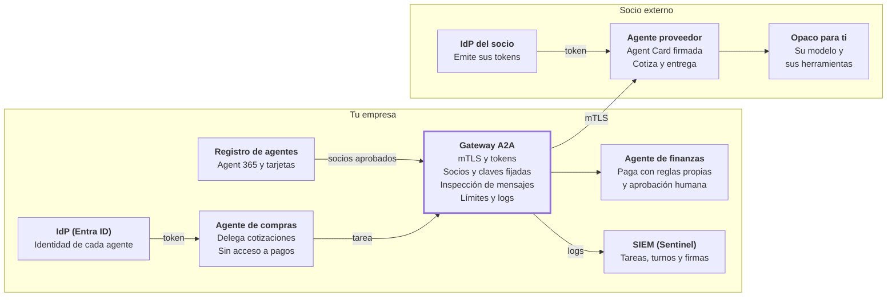

# A2A a fondo: agentes que hablan con agentes

> Parte de la guía *IA Empresarial Segura 2026*. [Índice de la guía](README.md)

A2A es el protocolo para que un agente delegue trabajo en otro, aunque sean de proveedores o empresas distintas. Su riesgo central es distinto al de MCP: **el agente remoto razona por su cuenta, así que lo que devuelve es la opinión de otro sistema que puede estar comprometido o equivocado**. Esta pestaña profundiza el capítulo 8 y el escenario 12.12; la práctica está en el Lab 18.

## 1. Cómo funciona A2A

A2A define cómo un agente cliente **descubre** a un agente remoto, le **encarga una tarea** y **recibe el resultado**, sin ver sus herramientas, su memoria ni su razonamiento. El agente remoto es opaco por diseño: eso permite colaborar entre empresas sin exponer el interior de cada sistema, y también obliga a confiar menos en lo que devuelve.

### Las piezas

| Pieza | Qué es | Relevancia de seguridad |
| --- | --- | --- |
| Agente cliente | El que delega la tarea | Decide qué datos envía y qué hace con la respuesta |
| Agente remoto | El que ejecuta la tarea | Puede estar comprometido o equivocado |
| Agent Card | Documento JSON publicado en `/.well-known/agent-card.json` con nombre, descripción, habilidades, interfaces soportadas (`supportedInterfaces`), esquemas de autenticación y firmas. Cada firma es un JWS cuya cabecera protegida incluye `alg`, `kid` y `typ`, calculado sobre la tarjeta canonicalizada con RFC 8785 y sin el campo de firmas | Es lo primero que lee el cliente; puede ser falsa o traer instrucciones |
| Extended Agent Card | Versión ampliada que se obtiene con la operación *Get Extended Agent Card*, solo para clientes autenticados; se anuncia con `capabilities.extendedAgentCard` | Lo interno nunca va en la tarjeta pública |
| Tarea | Unidad de trabajo con estados: enviada, en curso, requiere información, requiere autenticación, completada, fallida, cancelada y rechazada | Puede durar minutos u horas y acumular contexto |
| Mensajes, partes y artefactos | Texto, archivos y datos estructurados que van y vuelven | Canal de inyección y de fuga de datos |
| Streaming y notificaciones push | Actualizaciones por SSE o llamadas a un webhook del cliente | El webhook es una URL que alguien controla |
| Bindings | JSON-RPC, gRPC y HTTP/REST | El gateway debe entender los que uses |

Verificado contra la [especificación oficial 1.0.0](https://github.com/a2aproject/A2A/blob/main/docs/specification.md). Los esquemas de autenticación que una tarjeta puede declarar son API key, HTTP, OAuth 2.0 (código de autorización, credenciales de cliente y código de dispositivo), OpenID Connect y mTLS.

### Versiones y adopción

| Momento | Hito |
| --- | --- |
| 2026 | Versión 1.0.0, la vigente en la especificación oficial (publicada en marzo o abril según la fuente): define cómo firmar y verificar Agent Cards, cambia la estructura de la tarjeta a una lista de interfaces soportadas, añade multi-tenancy y tres bindings; migrar desde 0.x requiere cambios ([Quarkus](https://quarkus.io/blog/a2a-java-sdk-1-0-0-alpha1/)). El SDK oficial de Python va por la versión 1.2 en octubre de 2026. Al cumplir un año, el proyecto reportaba más de 150 organizaciones y soporte en plataformas de Google, Microsoft y AWS ([HPCwire](https://www.hpcwire.com/off-the-wire/linux-foundation-a2a-protocol-marks-one-year-with-broad-enterprise-and-cloud-adoption/)); la Agentic AI Foundation publica guías de v1.0 ([AAIF](https://aaif.io/blog/a2a-v1-0-a-builder-s-guide-part-2-migration-security-and-production)) |
| 2025 | Versión 0.3 con gRPC y firmas de Agent Card opcionales; donación a la Linux Foundation; Microsoft anuncia soporte en Foundry y Copilot Studio |
| abr 2025 | Google lanza A2A |

### A2A frente a MCP

| Aspecto | MCP | A2A |
| --- | --- | --- |
| Qué conecta | Agente con herramientas y datos | Agente con agente |
| Quién razona del otro lado | Nadie: la herramienta ejecuta | El agente remoto, con su propio modelo |
| Unidad de trabajo | Llamada a herramienta, normalmente corta | Tarea con estados, puede ser larga |
| Descubrimiento | Listado de herramientas | Agent Card |
| Autenticación | OAuth 2.1 con el servidor como resource server | La tarjeta declara esquemas (API key, HTTP, OAuth 2.0, OpenID Connect, mTLS); el protocolo los anuncia pero no los impone |
| Riesgo típico | Abuso de herramientas y cadena de suministro | Confianza excesiva en la respuesta y fuga de datos al otro agente |

Un sistema real usa los dos: el agente de compras llama a su ERP por MCP y delega la cotización al agente del proveedor por A2A.

## 2. Arquitectura de referencia

El agente que habla con el exterior **no habla directamente con nadie**: sus tareas pasan por un gateway A2A que autentica en ambos sentidos, solo acepta socios y claves aprobados, inspecciona los mensajes y registra todo. Y ese agente no tiene acceso a sistemas sensibles: delega en agentes internos que aplican sus propias reglas.



*Diagrama: arquitectura A2A · agentes internos, gateway y un socio externo.*

Del lado del socio todo es opaco: no ves su modelo ni sus herramientas, solo su tarjeta firmada y sus respuestas, que tu agente valida antes de usarlas.

| Componente | Qué decide | En Microsoft |
| --- | --- | --- |
| IdP | Quién es cada agente propio y con qué IdP de socios se federa | Entra ID y Entra Agent ID |
| Registro de agentes | Qué agentes y tarjetas (con su clave) están aprobados | Agent 365 |
| Gateway A2A | Si cada tarea se permite, con qué datos y límites | Azure API Management |
| Agente que habla con el exterior | Qué delega y cómo valida las respuestas | Foundry Agent Service, Copilot Studio |
| Agentes internos | Las acciones sensibles, con sus reglas y aprobación humana | Foundry, Logic Apps, Power Automate |
| SIEM | Qué pasó entre agentes y si es un incidente | Sentinel |

## 3. Identidad y confianza entre agentes

En A2A hay que resolver cinco preguntas antes de aceptar una tarea o una respuesta: **quién es este agente, en nombre de quién actúa, qué puede pedir, cuánto puede comprometer y cómo lo desconecto**. El protocolo transporta las respuestas, pero no las impone: eso lo hacen tu gateway y tu agente.

| Pregunta | Respuesta mínima aceptable |
| --- | --- |
| ¿Quién es este agente? | Un token emitido por un IdP de confianza, idealmente ligado a mTLS, y una Agent Card firmada con una clave que tienes registrada |
| ¿En nombre de quién actúa? | El usuario o proceso original viaja en el token (por ejemplo, con token exchange y un claim de actor), no en el texto del mensaje |
| ¿Qué puede pedir? | Solo las habilidades autorizadas para ese agente o socio |
| ¿Cuánto puede comprometer? | Límites de autoridad: montos, tipos de acción, datos que puede recibir |
| ¿Cómo lo desconecto? | Revocando sus credenciales y quitándolo de la lista permitida del gateway |

### Dentro de la empresa

- Cada agente tiene su propia identidad (en Microsoft, Entra Agent ID) y un sponsor.
- Las llamadas A2A llevan un token con la audiencia del agente destino, como en MCP.
- Cuando el orquestador actúa por un usuario, delega con OBO o token exchange y el token conserva la cadena de delegación; el agente destino autoriza con la identidad del usuario, no con la del orquestador.

### Entre empresas

- **Autenticación mutua:** mTLS más OAuth con credenciales de cliente, o federación de identidades entre los IdP de ambas empresas.
- **Una aplicación registrada por socio**, con sus propios scopes y límites; nunca credenciales compartidas entre socios.
- **Agent Cards firmadas:** el cliente verifica la firma con la clave que el socio entregó por un canal fuera de banda (contrato, portal de proveedores) y fija esa clave en el gateway.

**Integridad no es confianza.** Una firma válida prueba que la tarjeta no cambió desde que la firmó quien tiene esa clave; no prueba que esa entidad sea la que dice ser ni que la tarjeta sea inofensiva ([análisis](https://levelup.gitconnected.com/a2as-signed-agent-cards-prove-integrity-not-identity-2b1a017341ce)). La confianza la decides tú al aprobar y fijar la clave y el contenido de la tarjeta (Lab 18).

## 4. Catálogo de amenazas

Los ataques de A2A explotan la **confianza implícita entre agentes**: el cliente cree en la tarjeta, en la identidad y en la respuesta del otro. Unit 42 lo resumió al presentar *agent session smuggling*: el problema no es una falla del protocolo sino de cómo los agentes confían unos en otros ([Unit 42, 2025](https://unit42.paloaltonetworks.com/agent-session-smuggling-in-agent2agent-systems/)).

| Amenaza | Cómo funciona | Control |
| --- | --- | --- |
| Suplantación de agente | Una Agent Card falsa o un endpoint que imita a un socio | Firma verificada contra una clave fijada, mTLS, lista permitida en el gateway |
| Envenenamiento de la Agent Card | La descripción o las habilidades de la tarjeta traen instrucciones que el modelo del cliente obedece ([Keysight, 2026](https://keysight.com/blogs/en/tech/nwvs/2026/03/12/agent-card-poisoning)) | Revisar y fijar el contenido aprobado de la tarjeta; no pasar sus textos al modelo sin filtrar |
| Agent session smuggling | Un agente malicioso aprovecha una conversación de varios turnos para colar instrucciones encubiertas al agente víctima | Límite de turnos, contexto aislado por tarea, mostrar al usuario las interacciones relevantes, aprobación de acciones |
| Inyección en mensajes y artefactos | La respuesta del agente remoto trae instrucciones para el agente cliente | Tratar la respuesta como dato: validación por esquema, Prompt Shields, regla de dos |
| Fuga de datos hacia el agente remoto | El cliente envía más contexto del necesario (historial, documentos, datos personales) | Contrato de datos por habilidad, minimización, DLP en el gateway |
| Abuso de notificaciones push | La URL del webhook apunta a un recurso interno o a un tercero (riesgo de diseño del patrón de callbacks) | Validar y limitar URLs de callback, autenticar las notificaciones |
| Robo y repetición de tokens | Un token interceptado se reutiliza contra el agente | Tokens de vida corta con audiencia, ligados a mTLS cuando sea posible |
| Escalada por delegación | Un agente intermedio usa permisos del usuario para algo que el usuario no pidió | OBO con alcance reducido y cadena de delegación en el token |
| Fallas en cascada y bucles | Agentes que se delegan tareas en círculo o propagan un error | Profundidad máxima, timeouts, presupuestos por tarea, circuit breakers |
| Agente remoto comprometido | El socio sufre un incidente y su agente empieza a devolver datos o pedidos maliciosos | Validar resultados contra reglas de negocio, segundo control en acciones de alto impacto, kill switch por socio |
| Repudio | Nadie puede demostrar qué acordó cada agente | Logs completos de tareas y mensajes, firmas, límites de autoridad en el contrato |
| Consumo excesivo | Un socio satura al agente con tareas | Límites por socio y por habilidad en el gateway |

## 5. Controles y patrones de diseño

La regla de base es la del capítulo 4 aplicada a otro agente: **la respuesta de un agente remoto es contenido no confiable**, así que no puede decidir por sí sola qué acciones ejecuta el tuyo. Los patrones siguientes la ponen en práctica.

| Patrón | Cómo funciona | Ejemplo |
| --- | --- | --- |
| Contrato de datos por habilidad | Para cada habilidad se define qué datos salen (mínimos) y qué esquema debe tener la respuesta | La cotización solo envía código de producto y cantidad; la respuesta debe traer precio, moneda y plazo |
| Validación de resultados | La respuesta pasa por validación de esquema y reglas de negocio antes de usarse; el texto libre nunca se ejecuta como instrucción | Un precio 50% por debajo del histórico se marca para revisión |
| Límites de autoridad | El agente no puede comprometer gastos, contratos o datos por encima de un umbral sin aprobación humana | Compras mayores a 10.000 USD requieren doble aprobación |
| Contexto aislado por tarea | Cada tarea con un socio empieza con contexto limpio y un máximo de turnos | Evita que una conversación larga acumule instrucciones encubiertas |
| Orquestador con mínimo privilegio | El agente que habla con el exterior no tiene acceso directo a sistemas sensibles; delega en agentes internos con sus propias identidades | El agente de compras no paga: pide al agente de finanzas, que aplica sus reglas |
| Presupuesto por cadena | Profundidad máxima, tiempo y tokens por tarea, en todos los saltos | Una tarea no puede pasar por más de tres agentes |
| Kill switch por socio | Un solo cambio en el gateway corta todo el tráfico con un socio | Respuesta inmediata si el socio reporta un incidente |

### Checklist para publicar o consumir un agente por A2A

- [ ] Identidad propia del agente y sponsor asignado
- [ ] Agent Card pública sin detalles internos; detalles solo en la tarjeta extendida para clientes autenticados
- [ ] Tarjeta firmada y clave de cada socio fijada en el gateway
- [ ] Autenticación mutua y tokens de vida corta con audiencia
- [ ] Habilidades autorizadas por socio y límites de autoridad documentados
- [ ] Contrato de datos por habilidad y DLP en el gateway
- [ ] Validación de esquema y reglas de negocio sobre cada respuesta
- [ ] URLs de notificaciones push validadas y autenticadas
- [ ] Límite de turnos, profundidad, tiempo y tokens por tarea
- [ ] Logs completos de tareas y mensajes en el SIEM y kill switch probado

## 6. A2A en Microsoft y en el mercado

Microsoft se sumó a A2A en mayo de 2025 con soporte en Foundry y Copilot Studio y hoy lo integra en sus plataformas de agentes; en el lado de control, API Management gobierna el tráfico A2A y Agent 365 lleva el inventario. Fuera de Microsoft, A2A está en Google y AWS, y en las plataformas de agentes de los principales SaaS empresariales.

### En Microsoft

| Producto | Papel en A2A | Nota de seguridad |
| --- | --- | --- |
| Foundry Agent Service y Microsoft Agent Framework | Construir agentes que llaman a otros por A2A o que se publican como agentes A2A | Identidad del agente en Entra; validación de respuestas en el código |
| Copilot Studio | Conectar agentes low-code con agentes A2A de otras plataformas | Políticas de datos de Power Platform y revisión antes de compartir |
| Azure API Management | APIs de agentes A2A en GA desde junio 2026; `llm-content-safety` inspecciona el texto de los mensajes A2A | Es el punto donde vive la lista permitida de socios, límites y logs |
| Agent 365 | Registro y control de agentes de distintas plataformas | Inventario de qué agentes hablan con quién |
| Entra ID y Entra Agent ID | Identidad de cada agente y federación con IdP de socios | Acceso condicional y revisiones de acceso también para agentes |
| Purview | Clasificación y DLP de los datos que viajan en las tareas | Evita que salgan datos etiquetados hacia agentes externos |
| Sentinel y Defender XDR | Detección sobre los logs del gateway y de los agentes | Consultas de la sección 7 |

### En el mercado

| Plataforma | Soporte de A2A |
| --- | --- |
| Google | Creador del protocolo; ADK y su plataforma de agentes empresariales |
| AWS | Soporte de A2A en Amazon Bedrock AgentCore Runtime ([HPCwire](https://www.hpcwire.com/off-the-wire/linux-foundation-a2a-protocol-marks-one-year-with-broad-enterprise-and-cloud-adoption/)) |
| Salesforce, SAP, ServiceNow | Miembros del ecosistema A2A con plataformas de agentes propias; confirma el estado de cada integración con el proveedor |
| Gateways | Kong Agent Gateway, agentgateway e IBM ContextForge gobiernan tráfico A2A junto con MCP |

**Lo que verás en empresas en 2026:** A2A se usa sobre todo **dentro** de la organización, para conectar agentes de distintas plataformas (Copilot Studio con Agentforce o con un agente propio en Foundry). El uso **entre empresas** existe en compras, logística y seguros, pero todavía es la minoría y suele empezar con un socio de confianza y un contrato específico.

## 7. Detección, gobierno y repaso

Para investigar un incidente entre agentes necesitas saber **qué agentes hablaron, qué datos cruzaron la frontera, qué tarjeta y qué clave se verificaron, y cuántos turnos duró cada tarea**. El gateway A2A es el lugar natural para registrarlo.

### Qué registrar por tarea

Identidad del agente cliente y del remoto, socio, habilidad, usuario original, resultado de la verificación de la tarjeta y el identificador de la clave, transiciones de estado, número de turnos, tamaño y clasificación de los datos enviados, URLs de notificación y duración.

### Consultas KQL

Suponen una tabla `A2AGateway_CL` alimentada por tu gateway; adapta nombres a tu esquema.

**1. Firma inválida o clave nueva en la tarjeta de un socio:**

```kql
A2AGateway_CL
| where TimeGenerated > ago(1d)
| summarize Fallos = countif(FirmaValida == false), Claves = make_set(IdClave) by Socio, AgenteRemoto
| where Fallos > 0 or array_length(Claves) > 1
```

**2. Datos etiquetados que salen hacia agentes externos:**

```kql
A2AGateway_CL
| where TimeGenerated > ago(1d) and Direccion == "saliente" and Externo == true
| where EtiquetaDatos in ("Confidencial", "Altamente confidencial")
| summarize Tareas = count(), Habilidades = make_set(Habilidad) by Socio, AgenteCliente
```

**3. Conversaciones anormalmente largas (posible session smuggling):**

```kql
A2AGateway_CL
| where TimeGenerated > ago(1d)
| summarize Turnos = max(Turno) by IdTarea, Socio, AgenteCliente
| where Turnos > 10
```

**4. Primer contacto con un agente externo:**

```kql
let conocidos = A2AGateway_CL | where TimeGenerated between (ago(30d) .. ago(1d)) | distinct AgenteRemoto;
A2AGateway_CL
| where TimeGenerated > ago(1d) and Externo == true
| where AgenteRemoto !in (conocidos)
| summarize Primera = min(TimeGenerated), Tareas = count() by AgenteRemoto, Socio
```

### Alta de un socio por A2A

1. **Evaluación del socio** y contrato con tratamiento de datos y responsabilidades por lo que acuerden los agentes.
2. **Intercambio de claves y credenciales** fuera de banda; registro de la clave de firma en el gateway.
3. **Habilidades autorizadas, contrato de datos y límites de autoridad** por habilidad.
4. **Pruebas:** tarjeta manipulada, firma con otra clave, respuesta con instrucciones, datos fuera de contrato (Lab 18).
5. **Puesta en producción** con límites conservadores y monitoreo reforzado los primeros 30 días.
6. **Revisión periódica** y plan de corte coordinado si el socio tiene un incidente.

### Preguntas de repaso

1. ¿Por qué una Agent Card firmada no basta para confiar en un agente?
2. ¿Qué diferencia hay entre session smuggling y una inyección indirecta clásica?
3. Diseña el contrato de datos de una habilidad “cotizar envío”: qué sale y qué esquema debe tener la respuesta.
4. ¿Dónde aplicarías el kill switch de un socio en una arquitectura con API Management?
5. ¿Por qué el agente que habla con socios externos no debería tener acceso directo a pagos?
