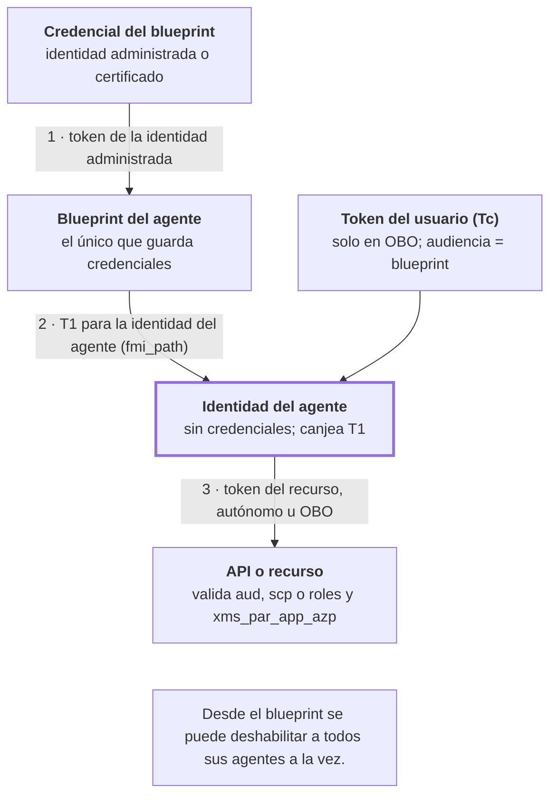

# Agentes con Entra: SDK, límites y mitos

> Parte de la guía *IA Empresarial Segura 2026*. [Índice de la guía](README.md)

Oct 18, 2026 · Danilo Bustamante

Un agente bien conectado a Entra cumple tres reglas. **No tiene claves**: pide tokens con una identidad administrada o con su identidad de Entra Agent ID. **Tiene identidad propia**, para que cada acción se pueda atribuir, auditar y bloquear sin tocar a nadie más. Y cuando **actúa por una persona** usa un token delegado con los permisos mínimos de esa persona, nunca los suyos.

Entra decide quién es el agente y a qué recursos llega. No ve qué hace con esos permisos, así que no reemplaza al gateway, a los guardrails ni a la aprobación humana (capítulos 3 y 5).

El código de esta pestaña usa las versiones actuales de los SDK: Microsoft Agent Framework 1.22, azure-identity 1.26, azure-ai-projects 2.7, MSAL 1.39, OpenAI Agents SDK 0.24 y langchain-openai 1.7. El **Lab 21** lo ejecuta en tu computadora contra un Entra simulado, sin cuenta de Azure.

## 1. Los cuatro modos de identidad de un agente

La primera decisión es con qué identidad actúa el agente en cada llamada. Un mismo agente puede usar dos modos: autónomo para su trabajo de fondo y en nombre del usuario cuando atiende una conversación.

| Modo | Cuándo usarlo | Quién aparece en el token | Cómo obtiene el token | SDK |
| --- | --- | --- | --- | --- |
| Identidad administrada, sin Agent ID | Agente propio en Azure que solo llama a servicios de Azure (modelos, AI Search, Storage) | La identidad administrada; token solo de aplicación | El SDK lo pide al endpoint de identidad de Azure; tú asignas roles RBAC | azure-identity, `ManagedIdentityCredential` |
| Agente autónomo con Entra Agent ID | Trabaja solo: procesa colas, revisa alertas, responde tickets | La identidad del agente (`idtyp=app`); permisos en `roles` | El blueprint obtiene un token intermedio (T1) y la identidad del agente lo canjea por el del recurso | Sidecar de Entra o Microsoft.Identity.Web con `WithAgentIdentity` |
| Agente interactivo, en nombre del usuario | Asistente que lee el correo, los archivos o los pedidos de quien conversa con él | El usuario como sujeto (`idtyp=user`) y el agente como actor; permisos delegados en `scp` | On-behalf-of: la app cliente obtiene el token del usuario con audiencia del blueprint y el agente lo canjea | Sidecar con el token del usuario, o `GetForUserAsync` con `WithAgentIdentity` |
| Agente con cuenta de usuario propia | Necesita buzón, Teams o un sistema que solo acepta usuarios | La cuenta de usuario del agente (`idtyp=user`, `xms_sub_fct` con 13) | Cadena blueprint, identidad del agente y cuenta de usuario (`grant_type=user_fic`) | Sidecar con `AgentUsername` o `AgentUserId`; `WithAgentUserIdentity` |

**Si usas Foundry o Copilot Studio, parte de esto ya está hecho.** Los hosted agents de Foundry Agent Service reciben una identidad de agente al desplegarse, y Copilot Studio registra a sus agentes en Entra Agent ID (capítulo 9.2). Lo que sigue siendo tuyo: qué permisos les das, quién es el sponsor, qué políticas de Conditional Access aplican y cada cuánto se revisan.

**Regla para elegir:** si el agente lee datos de una persona, usa el modo en nombre del usuario, aunque también tenga permisos propios. Así nunca ve más de lo que esa persona puede ver, que es la defensa más simple contra el oversharing (capítulo 7).

## 2. Entra Agent ID por dentro

La idea que lo ordena todo: **la identidad del agente no tiene credenciales; las tiene el blueprint**, y Entra encadena dos tokens para que el agente obtenga el suyo.



*Diagrama: flujo de tokens de Entra Agent ID · 3 pasos, OBO opcional.*

En el modo autónomo no hay usuario y el token final es solo de aplicación. En OBO, el paso 3 usa además el token del usuario y el resultado lo tiene como sujeto.

- **Blueprint.** Es la plantilla de un tipo de agente y el único que guarda credenciales. Microsoft recomienda una credencial federada respaldada por una identidad administrada; los secretos, solo en desarrollo. Desde el blueprint se aplican políticas, se deshabilitan o se revocan permisos para todos sus agentes a la vez.
- **Identidad del agente.** Es un service principal especial creado por el blueprint, con su propio ID, sponsor y registro de auditoría. Solo recibe tokens en el tenant donde se creó, aunque el blueprint sea multitenant. Un blueprint puede tener muchas identidades; una identidad tiene un solo blueprint.
- **Cuenta de usuario del agente (opcional).** Una cuenta de usuario marcada como agente, en relación 1 a 1 con la identidad del agente, para sistemas que solo aceptan usuarios.
- **Sin flujos interactivos.** Los agentes son siempre clientes confidenciales: no usan `/authorize` ni pueden pedir MFA. La identidad hija no puede recibir consentimiento interactivo (error `AADSTS82014`): los permisos delegados se configuran como heredables en el blueprint y un administrador los consiente ahí.

**Lo que ve tu API.** Un token emitido a un agente trae los claims de siempre más algunos propios. `xms_par_app_azp` es el ID del blueprint que lo creó, `azp` o `appid` es el ID de la identidad del agente, `idtyp` dice si el sujeto es una app o un usuario, y `xms_sub_fct` con el valor 13 distingue una cuenta de usuario de agente de una persona. Con eso tu API puede aceptar solo a los agentes de un blueprint aprobado y registrar quién hizo qué.

## 3. Código: agente sin claves

El agente le pasa una **credencial** al SDK y el SDK pide los tokens, los guarda en caché y los renueva. No hay `api_key` en ninguna parte.

**Microsoft Agent Framework con Azure OpenAI (Python).** El cliente pide tokens para `https://cognitiveservices.azure.com/.default`; la identidad necesita el rol *Cognitive Services OpenAI User* en el recurso.

```python
import os

from agent_framework import Agent
from agent_framework.openai import OpenAIChatCompletionClient
from azure.identity import DefaultAzureCredential, ManagedIdentityCredential

# En Azure, la identidad administrada del agente; en tu equipo, tu sesión de az login
credencial = (ManagedIdentityCredential(client_id=os.environ["AZURE_CLIENT_ID"])
              if "AZURE_CLIENT_ID" in os.environ else DefaultAzureCredential())

cliente = OpenAIChatCompletionClient(
    model="gpt-4.1-mini",                              # nombre del despliegue
    azure_endpoint="https://mi-recurso.openai.azure.com",
    api_version="2024-10-21",
    credential=credencial)

agente = Agent(cliente, "Eres el asistente de compras.", name="agente-compras",
               tools=[consultar_pedidos])              # función Python, ver sección 4
respuesta = await agente.run("¿Qué pedidos tengo pendientes?")
print(respuesta.text)
```

**Foundry Agent Service (Python).** `AIProjectClient` pide tokens para `https://ai.azure.com/.default`. Para crear y probar agentes, la identidad necesita *Azure AI User* (en la documentación más nueva, *Foundry User*); para solo invocarlos, el rol más acotado *Foundry Agent Consumer*.

```python
from azure.ai.projects import AIProjectClient
from azure.identity import DefaultAzureCredential

proyecto = AIProjectClient(
    endpoint="https://mi-recurso.services.ai.azure.com/api/projects/mi-proyecto",
    credential=DefaultAzureCredential())
cliente_openai = proyecto.get_openai_client()   # cliente OpenAI ya autenticado con Entra
```

**DefaultAzureCredential, con cuidado en producción.** Prueba varias credenciales en orden hasta que una funciona, lo que en un servidor puede terminar usando una que no esperabas. En producción usa la credencial explícita, o fija la variable `AZURE_TOKEN_CREDENTIALS` en `prod` para que descarte las de desarrollo; en tu equipo, `dev`.

## 4. Código: agente que actúa en nombre del usuario

El flujo on-behalf-of (OBO) tiene tres pasos. La app cliente inicia sesión del usuario y pide un token **cuya audiencia es el agente**, no Graph. El agente recibe ese token y lo canjea por uno para la API de destino. La API ve al usuario como sujeto y al agente como actor, con los permisos delegados en `scp`.

**Opción A: agente sin Entra Agent ID, con MSAL (Python).** El agente es una app registrada clásica. Su credencial es un token de su identidad administrada, así que tampoco hay secreto; la app necesita una credencial federada que confíe en esa identidad administrada.

```python
import msal
from azure.identity import ManagedIdentityCredential

identidad = ManagedIdentityCredential(client_id=ID_IDENTIDAD_ADMINISTRADA)

def assertion_federada():
    # La identidad administrada es la credencial federada de la app del agente
    return identidad.get_token("api://AzureADTokenExchange/.default").token

app_agente = msal.ConfidentialClientApplication(
    client_id=ID_APP_AGENTE,
    authority=f"https://login.microsoftonline.com/{ID_TENANT}",
    client_credential={"client_assertion": assertion_federada})

def token_para_graph(token_del_usuario):
    resultado = app_agente.acquire_token_on_behalf_of(
        user_assertion=token_del_usuario,
        scopes=["https://graph.microsoft.com/Mail.Read"])   # solo lo que la tarea necesita
    if "access_token" not in resultado:
        raise PermissionError(resultado.get("error_description"))
    return resultado["access_token"]
```

**Opción B: agente con Entra Agent ID, con el sidecar.** Es la vía que recomienda Microsoft, porque los canjes de la sección 2 no son triviales de implementar. El agente le pasa el token del usuario al sidecar y recibe el encabezado listo. Este código es el del Lab 21, probado contra el simulador.

```python
import requests

SIDECAR = "http://sidecar:5000"   # mismo pod o red interna; nunca expuesto al exterior

def encabezado_para_pedidos(id_agente, token_del_usuario=None):
    if token_del_usuario:   # en nombre del usuario (OBO)
        r = requests.get(f"{SIDECAR}/AuthorizationHeader/pedidos",
                         params={"AgentIdentity": id_agente},
                         headers={"Authorization": f"Bearer {token_del_usuario}"}, timeout=10)
    else:                   # autónomo, con la identidad del agente
        r = requests.get(f"{SIDECAR}/AuthorizationHeaderUnauthenticated/pedidos",
                         params={"AgentIdentity": id_agente}, timeout=10)
    r.raise_for_status()
    return r.json()["authorizationHeader"]   # "Bearer eyJ..."
```

**Llamar a un servidor MCP con el token del usuario (Agent Framework).** `MCPStreamableHTTPTool` acepta un `header_provider` que arma los encabezados en cada conexión a partir de los argumentos de ejecución, así que cada usuario llega al servidor MCP con su propio token y el modelo nunca lo ve. Este fragmento sigue la firma de Agent Framework 1.22; no se ejecutó contra un servidor MCP real.

```python
from agent_framework import Agent, MCPStreamableHTTPTool

mcp_pedidos = MCPStreamableHTTPTool(
    name="pedidos",
    url="https://mcp-pedidos.contoso.com/mcp",
    header_provider=lambda contexto: {"Authorization": contexto["autorizacion_mcp"]})

agente = Agent(cliente, "Atiende consultas de pedidos.", tools=[mcp_pedidos])
respuesta = await agente.run(
    pregunta,
    function_invocation_kwargs={"autorizacion_mcp": encabezado_para_pedidos(ID_AGENTE, token_del_usuario)})
```

El servidor MCP valida ese token como cualquier API protegida con Entra: audiencia, emisor, firma y scopes (pestaña MCP a fondo y Lab 15).

## 5. Código: agente con su propia identidad de Entra Agent ID

Hay dos SDK oficiales. El **sidecar** sirve para cualquier lenguaje porque se le habla por HTTP. **Microsoft.Identity.Web** es para .NET y corre dentro del proceso.

**Configuración del sidecar** (fragmento de `docker-compose.yml`, según el ejemplo oficial de Microsoft). El `ClientId` es el del **blueprint**, no el del agente. En desarrollo el ejemplo usa `ClientSecret`; en Azure se cambia a `SignedAssertionFromManagedIdentity` sin tocar el código del agente.

```yaml
sidecar:
  image: mcr.microsoft.com/entra-sdk/auth-sidecar:1.0.0-azurelinux3.0-distroless
  # Sin ports: solo el contenedor del agente puede pedirle tokens
  environment:
    - AzureAd__Instance=https://login.microsoftonline.com/
    - AzureAd__TenantId=${TENANT_ID}
    - AzureAd__ClientId=${BLUEPRINT_APP_ID}
    - AzureAd__ClientCredentials__0__SourceType=SignedAssertionFromManagedIdentity
    - AzureAd__ClientCredentials__0__ManagedIdentityClientId=${UAMI_CLIENT_ID}
    # API de destino con token de aplicación (modo autónomo)
    - DownstreamApis__pedidos__BaseUrl=https://api.contoso.com/
    - DownstreamApis__pedidos__Scopes__0=api://pedidos/.default
    - DownstreamApis__pedidos__RequestAppToken=true
```

**Microsoft.Identity.Web (C#).** Se registra con `AddAgentIdentities()` y en cada llamada se elige la identidad: `GetForAppAsync` para el modo autónomo, `GetForUserAsync` para el modo en nombre del usuario y `WithAgentUserIdentity` para la cuenta de usuario del agente. El código es el de la documentación de Entra; no se compiló en este entorno.

```csharp
builder.Services.AddAuthentication(OpenIdConnectDefaults.AuthenticationScheme)
    .AddMicrosoftIdentityWebApp(builder.Configuration.GetSection("AzureAd"))
    .EnableTokenAcquisitionToCallDownstreamApi()
    .AddInMemoryTokenCaches();
builder.Services.AddDownstreamApis(builder.Configuration.GetSection("DownstreamApis"));
builder.Services.AddAgentIdentities();

// Autónomo: token de aplicación de la identidad del agente
var todos = await _api.GetForAppAsync<List<Pedido>>("Pedidos", "pedidos",
    options => options.WithAgentIdentity(idAgente));

// En nombre del usuario que llamó a esta API
var mios = await _api.GetForUserAsync<List<Pedido>>("Pedidos", "pedidos",
    options => options.WithAgentIdentity(idAgente));

// Con la cuenta de usuario del agente (UPN u object ID)
var delBuzon = await _api.GetForUserAsync<List<Pedido>>("Pedidos", "pedidos",
    options => options.WithAgentUserIdentity(idAgente, "agente-compras@contoso.com"));
```

**Del lado de la API: aceptar solo a tus agentes.** Después de validar firma, emisor y audiencia, revisa de qué blueprint viene el agente y con qué permisos llega.

```python
BLUEPRINTS_APROBADOS = {"11111111-0000-0000-0000-00000000b1ee"}

def autorizar(claims):
    if claims.get("xms_par_app_azp") not in BLUEPRINTS_APROBADOS:
        raise PermissionError("agente de un blueprint no aprobado")
    if claims["idtyp"] == "user":     # en nombre del usuario: permisos delegados
        return "Pedidos.Read" in claims.get("scp", "").split()
    return "Pedidos.Read.All" in claims.get("roles", [])   # autónomo: rol de aplicación
```

## 6. Otros frameworks: el mismo patrón

Cualquier framework que use el cliente de OpenAI acepta un **proveedor de tokens** en lugar de una clave. Se crea con `get_bearer_token_provider` de azure-identity, siempre con el scope del recurso. Estos dos fragmentos se ejecutaron en el Lab 21 contra el simulador.

```python
from azure.identity import DefaultAzureCredential, get_bearer_token_provider
from azure.identity.aio import DefaultAzureCredential as DefaultAzureCredentialAsync
from azure.identity.aio import get_bearer_token_provider as get_async_bearer_token_provider

SCOPE = "https://cognitiveservices.azure.com/.default"

# OpenAI Agents SDK: cliente asíncrono con el endpoint v1 de Azure OpenAI
from agents import Agent, OpenAIChatCompletionsModel, Runner
from openai import AsyncOpenAI

cliente = AsyncOpenAI(base_url="https://mi-recurso.openai.azure.com/openai/v1/",
                      api_key=get_async_bearer_token_provider(DefaultAzureCredentialAsync(), SCOPE))
agente = Agent(name="agente-pedidos", instructions="Responde corto.",
               model=OpenAIChatCompletionsModel(model="gpt-4.1-mini", openai_client=cliente))

# LangChain y LangGraph
from langchain_openai import AzureChatOpenAI

modelo = AzureChatOpenAI(azure_endpoint="https://mi-recurso.openai.azure.com",
                         azure_deployment="gpt-4.1-mini", api_version="2024-10-21",
                         azure_ad_token_provider=get_bearer_token_provider(DefaultAzureCredential(), SCOPE))
```

| Framework | Dónde va la identidad | Para llamar a herramientas en nombre del usuario |
| --- | --- | --- |
| Microsoft Agent Framework | `credential=` en el cliente | `header_provider` en las herramientas MCP; MSAL o el sidecar en funciones propias |
| OpenAI Agents SDK | Proveedor de tokens como `api_key` del cliente `AsyncOpenAI` | El token del usuario en el contexto de ejecución, leído por la función de la herramienta |
| LangChain y LangGraph | `azure_ad_token_provider=` en `AzureChatOpenAI` | El token en el estado o la configuración del grafo; el ejemplo oficial del sidecar usa un agente ReAct de LangGraph |
| Semantic Kernel | Credencial de Azure en el conector | Microsoft presenta a Agent Framework como su sucesor; para proyectos nuevos, empieza ahí |

En los cuatro casos vale la misma regla: **el token del usuario va en el código de la herramienta, nunca en el prompt ni en la memoria del agente**. Si el modelo lo ve, una inyección puede pedirle que lo copie en una respuesta.

## 7. Qué se puede y qué no

| Pregunta | Respuesta | Detalle |
| --- | --- | --- |
| ¿Un agente puede iniciar sesión interactiva o pasar un MFA? | No | Los agentes son clientes confidenciales: sin `/authorize`, sin cliente público y sin MFA |
| ¿La identidad del agente puede tener su propio secreto o certificado? | No | Las credenciales viven en el blueprint; la identidad del agente se autentica con lo que el blueprint le encadena |
| ¿Un agente puede acceder a otro tenant? | No | Las identidades de agente son de un solo tenant; un blueprint multitenant crea identidades locales en cada tenant |
| ¿Se puede aplicar Conditional Access a un agente? | Sí, acotado | A identidades de agente: solo bloquear, con la condición de riesgo del agente en preview. A cuentas de usuario de agente (preview): además dispositivo compatible, plataforma y red con Global Secure Access |
| ¿Qué licencia pide ese Conditional Access? | Microsoft 365 E7, o Agent 365 con Entra P1 o Microsoft 365 E3 | Según la guía de Entra actualizada en julio de 2026 |
| ¿Las políticas para “todos los usuarios” cubren a los agentes? | No | No incluyen cuentas de usuario de agente; las políticas de agentes aplican cuando el agente usa su propia identidad, no en OBO |
| ¿Conditional Access aplica a identidades administradas? | No | La política de identidades de carga de trabajo cubre service principals de un solo tenant y requiere Workload Identities Premium; las identidades administradas quedan fuera |
| ¿En OBO el agente puede hacer todo lo que puede el usuario? | No | Solo los scopes delegados consentidos, y nunca más de lo que el usuario puede |
| ¿El usuario puede consentir permisos a la identidad del agente? | No | Error `AADSTS82014`; se configuran permisos heredables en el blueprint con consentimiento de un administrador |
| ¿Entra detecta una inyección de prompts o un uso abusivo? | No | Decide quién y a qué, no qué se hace; para eso están el gateway, los guardrails, Defender y la aprobación humana |
| ¿Mi API puede saber que quien llama es un agente? | Sí | Con `xms_par_app_azp`, `idtyp` y `xms_sub_fct` |
| ¿Se pueden apagar las claves de Azure OpenAI? | Sí | `disableLocalAuth: true` en el recurso (capítulo 2) |
| ¿RBAC en Azure OpenAI controla qué documentos ve el agente? | No | El rol da acceso al modelo; el filtrado por documento va en el RAG (capítulo 7) |

## 8. Mitos y realidades

| Mito | Realidad |
| --- | --- |
| “Con identidad administrada no hay secretos en ningún lado.” | Dentro de Azure, sí. Fuera de Azure necesitas federación de identidades de carga de trabajo, y en desarrollo el SDK usa tu propia sesión de `az login`. |
| “Entra Agent ID protege contra la inyección de prompts.” | Decide quién es el agente y a qué llega. Un agente con identidad impecable obedece igual una instrucción escondida en un correo; lo que limita el daño es tener pocos permisos. |
| “Una identidad de agente es un service principal más.” | Es un tipo especial: sin credenciales propias, creada desde un blueprint, con sponsor y claims que la identifican, y gobernable por blueprint. |
| “Conditional Access le exige MFA al agente.” | No hay MFA para agentes. Para identidades de agente, la palanca es bloquear, con el riesgo del agente como señal. |
| “Si el agente usa el token del usuario, no necesita identidad propia.” | Pierdes la atribución: en los registros no se distingue lo que hizo la persona de lo que hizo el agente, y no puedes bloquear al agente sin bloquear a la persona. |
| “En OBO el agente hereda todo lo que puede el usuario.” | Hereda solo los scopes delegados que pidió y se consintieron. Por eso conviene pedir el mínimo por tarea. |
| “Un token sirve para todo.” | Cada token tiene una audiencia. Uno para Graph no sirve para Azure OpenAI ni para tu API, y en OBO el token del usuario debe tener como audiencia al agente (Lab 21, caso 3). |
| “DefaultAzureCredential es lo correcto en producción.” | Prueba varias credenciales en orden. En producción usa una explícita o fija `AZURE_TOKEN_CREDENTIALS=prod`. |
| “Los agentes de Foundry y Copilot Studio ya vienen seguros.” | Reciben su identidad automáticamente, pero los permisos, el sponsor, el Conditional Access y las revisiones de acceso siguen siendo decisiones tuyas. |
| “Le paso el token al modelo para que lo use en las herramientas.” | Nunca. El token va en el código de la herramienta o en el `header_provider`; si está en el contexto, una inyección puede exfiltrarlo. |

## 9. Errores comunes y cómo diagnosticarlos

Antes de cambiar permisos, decodifica el token que realmente se envió y mira `aud`, `idtyp`, `scp` o `roles` y `xms_par_app_azp`. Muchos problemas se ven ahí sin buscar más.

| Síntoma | Causa probable | Arreglo |
| --- | --- | --- |
| 401 en Azure OpenAI con audiencia inválida | El token se pidió para otro recurso | Scope `https://cognitiveservices.azure.com/.default`; en Foundry, `https://ai.azure.com/.default` |
| 403 de permiso denegado aunque el rol ya está dado | Falta el rol de datos (los roles de gestión no sirven para inferencia) o todavía no se propagó | *Cognitive Services OpenAI User* o *Azure AI User* en el recurso correcto; esperar unos minutos y pedir un token nuevo |
| `AADSTS50013` en el canje OBO | El token del usuario tiene otra audiencia, por ejemplo Graph | La app cliente pide el token con el scope que expone el blueprint del agente |
| `AADSTS82014` | Se intentó un consentimiento interactivo sobre la identidad del agente | Permisos heredables en el blueprint y consentimiento de un administrador |
| `AADSTS65001` | Nadie consintió los permisos delegados | Consentimiento del administrador para los scopes que pide el agente |
| Funciona en tu equipo y falla en Azure | En local usaba tu cuenta; en Azure, una identidad sin roles | Asignar los roles a la identidad administrada o a la identidad del agente |
| El servidor usa una credencial inesperada | `DefaultAzureCredential` encontró otra en la cadena | Credencial explícita o `AZURE_TOKEN_CREDENTIALS=prod` |
| Tu API rechaza el token del agente | La API no expone el rol o el scope que pide el agente, o no se lo asignaron | Exponer el permiso en el registro de la API, asignarlo a la identidad del agente y validar `xms_par_app_azp` |

## 10. Para repasar

1. Un asistente de compras lee los pedidos de quien conversa con él y, de noche, concilia todos los pedidos del día. ¿Qué modo de identidad usa en cada caso y qué permiso pide en cada uno?
2. ¿Por qué la identidad de un agente no puede tener un secreto propio, y dónde vive entonces la credencial?
3. Tu equipo quiere exigirle MFA al agente con Conditional Access. ¿Qué les respondes y qué controles sí puedes aplicar?
4. El canje OBO falla con `AADSTS50013`. ¿Qué revisas primero?

Para practicar: **Lab 21**, en la pestaña Laboratorios.

## Fuentes

Las páginas de Entra se leyeron completas en el repositorio público de documentación de Microsoft, y el código de los SDK se revisó en sus paquetes instalados.

- [Protocolos de autenticación de agentes](https://learn.microsoft.com/entra/agent-id/agent-oauth-protocols), [flujo autónomo](https://learn.microsoft.com/entra/agent-id/agent-autonomous-app-oauth-flow), [flujo on-behalf-of](https://learn.microsoft.com/entra/agent-id/agent-on-behalf-of-oauth-flow) y [cuenta de usuario del agente](https://learn.microsoft.com/entra/agent-id/agent-user-oauth-flow)
- [Identidades de agente](https://learn.microsoft.com/entra/agent-id/agent-identities) y [claims de los tokens de agentes](https://learn.microsoft.com/entra/agent-id/agent-token-claims)
- [Sidecar de Entra para agentes](https://learn.microsoft.com/entra/agent-id/authentication-with-auth-sdk-sidecar), [cómo pedirle tokens](https://learn.microsoft.com/entra/agent-id/microsoft-entra-sdk-for-agent-identities) y [ejemplos oficiales](https://github.com/microsoft/entra-agentid-samples/tree/dev/sidecar)
- [Llamar a APIs propias desde un agente con .NET](https://learn.microsoft.com/entra/agent-id/call-api-custom)
- [Conditional Access para identidades de agente](https://learn.microsoft.com/entra/identity/conditional-access/howto-target-agent-identities) y [para identidades de carga de trabajo](https://learn.microsoft.com/entra/identity/conditional-access/workload-identity)
- [Agentes hospedados en Foundry](https://learn.microsoft.com/azure/foundry/agents/concepts/hosted-agents) y [roles de Foundry](https://learn.microsoft.com/azure/foundry/concepts/rbac-foundry)
